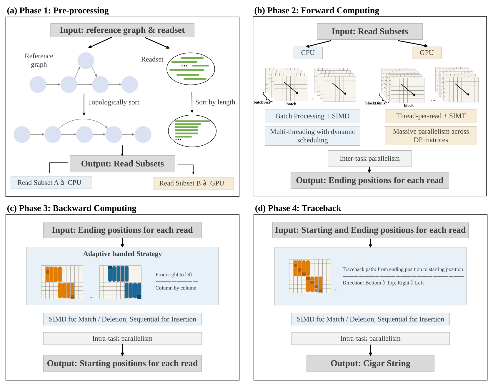

# HDGA

[](LICENSE)

HDGA (**H**eterogeneous **D**ifference-based **G**raph **A**ligner) is a high-performance sequence-to-graph alignment tool designed for heterogeneous CPU–GPU systems.  HDGA introduces a CPU–GPU collaborative parallel framework with a heuristic scheduling strategy to enable load-balanced execution across heterogeneous hardware. On top of this system design, it incorporates a difference-based recurrence formulation that maintains high SIMD parallelism regardless of read length, as well as an adaptive banded dynamic programming strategy that reduces unnecessary computation while preserving optimal alignment accuracy. HDGA builds upon the [PaSGAL](https://github.com/ParBLiSS/PaSGAL) framework for input preprocessing and output formatting. 

<p align="center">
  
  <br>
  <em>Fig: Workflow of HDGA.</em>
</p>


## Requirements

HDGA requires the following environment and libraries to build and run properly.

### Hardware Requirements

- **CPU**: AVX2 support required (tested on Intel Xeon Gold 6230)
- **GPU**: NVIDIA GPU with CUDA support (tested on RTX A6000)
- **Memory**: 64 GB RAM or higher recommended (256 GB used in our experiments)

HDGA is optimized for the `AVX2` instruction set. Please ensure your CPU supports AVX2 (check via `/proc/cpuinfo` on Linux).

---

### Software Requirements

- **Operating System**: Ubuntu 20.04 LTS
- **CUDA Toolkit**: 12.2
- **NVIDIA Driver**: 535.183.01
- **Compiler**:
  - Intel oneAPI DPC++/C++ Compiler (recommended)
  - or GCC with C++17 support (AVX2 enabled)
- **CMake**: ≥ 3.1

---

### Required Libraries and Tools

- System development packages:
  - `zlib1g-dev`
  - `libbz2-dev`
  - `liblzma-dev`
- [Google Protobuf](https://github.com/protocolbuffers/protobuf) (can also be installed via conda)

---

### Notes

- Intel oneAPI compiler is recommended for better SIMD optimization on Intel CPUs.
- GPU acceleration requires a CUDA-capable device with sufficient memory (≥16 GB recommended).

---

## Installation and Deployment
### Build
```sh
git clone https://github.com/nudt-bioinfo/HDGA.git
cd HDGA
./build.sh
```

HDGA provides an interactive build script to compile different execution modes, you will be prompted to select the build target:

- **CPU version** (AVX2 required)
- **GPU version** (CUDA required)
- **Hybrid version** (CPU–GPU collaborative, recommended)

The script will automatically configure and compile the selected components.

### Run

HDGA provides a unified execution script:
```sh
./run.sh
```
The script supports interactive configuration of the following options:

- Execution mode:
  - CPU
  - GPU
  - CPU–GPU collaborative (recommended)

- Number of CPU threads
- Input datasets:
  - Reference graph (e.g., BRCA1.vg, LRC.vg)
  - Read set
- Output path
- Alignment configuration:
  - Enable/disable adaptive banded mode

## Quickstart
The following example demonstrates how to run HDGA using the provided script and built-in datasets:
```sh
./run.sh
========================================
           HDGA Interactive Run         
========================================

Select run mode:
1) CPU
2) GPU
3) Hybrid (CPU+GPU collaborative)
Enter choice [1-3]: 1

Enter number of CPU threads (default 16): 

Enter path to reference graph (.vg): data/graph/sars_cov_2.vg 

Enter path to reads file (.fastq/.fa): data/reads/reads.fq 

Enter output file prefix (default hdga_output): outputfile

Enable adaptive banded mode?
1) Yes (recommended for long reads)
2) No
Enter choice [1-2]: 2

========================================
Running HDGA with the following config:
Mode: cpu
Build dir: /home/wqz/HDGA/HDGA/build_cpu
Threads: 16
Graph: /home/wqz/HDGA/HDGA/data/graph/sars_cov_2.vg
Reads: /home/wqz/HDGA/HDGA/data/reads/reads.fq
Output: outputfile
Banded: --disable-banded
========================================

>> [START] Phase1: forward computing
<< [DONE ] Phase1: forward computing [vectorized <16bit per cell>] | Cost: 0.505 s
>> [START] Phase2: backward computing & traceback
    >> [START] backward computing
    << [DONE ] backward computing [disable banded] | Cost: 0.025 s
    >> [START] traceback
    << [DONE ] traceback [disable banded] | Cost: 0.026 s
<< [DONE ] Phase2: backward computing & traceback [disable banded] | Cost: 0.052 s
INFO, hdga::main, run finished

Done.
```

## License

HDGA is released under the MIT License.  
This repository includes portions derived from the PaSGAL project, which is also licensed under MIT.